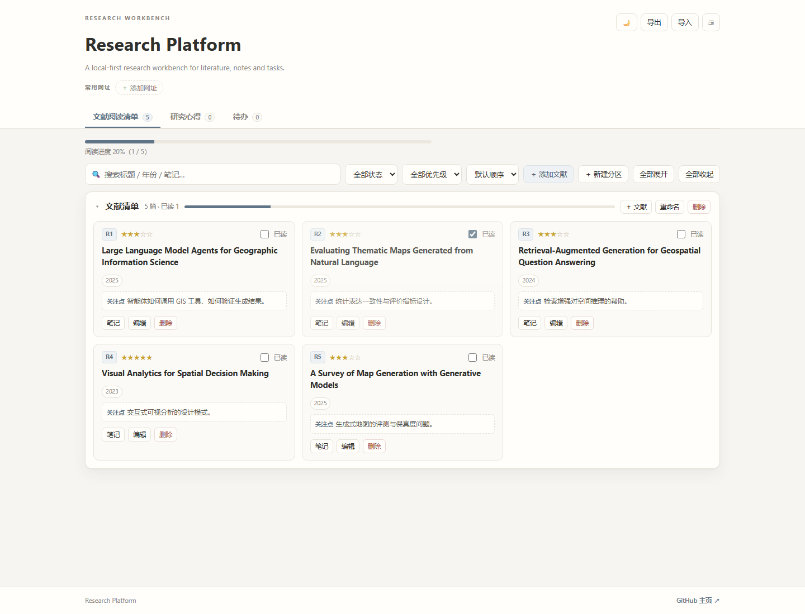

# Research Platform

一个**本地优先的科研工作台**，把文献阅读、研究心得和待办放在同一个页面里管理。原生 HTML / CSS / JavaScript，无需后端、无需构建、无需安装依赖。



> 截图为示例数据。

## 能做什么

### 文献阅读清单

- 按分区管理文献，分区可折叠、重命名、删除；
- 五星优先级、已读状态、年份、原文链接；
- 记录“关注点 / 读什么”，卡片上直接查看；
- 搜索，按状态 / 星级筛选，按优先级 / 年份 / 标题排序；
- 每篇文献可打开独立的**笔记小窗**写长笔记；
- 顶部显示阅读进度。

### 研究心得

- 左侧编辑区 + 右侧心得列表的主从布局；
- 标题、正文、标签、置顶；
- 搜索、筛选置顶、按更新时间 / 创建时间 / 标题排序；
- 输入自动保存，显示字数和更新时间。

### 待办

- 输入后回车即可添加；
- 高 / 中 / 低优先级、截止日期、标签、备注；
- 勾选完成、过期标红、清除已完成；
- 搜索，按全部 / 未完成 / 已完成筛选，按优先级 / 截止日期 / 创建时间排序。

### 常用网址

- 在页面顶部添加固定网址；
- 点击直接在新标签页打开；
- 可随时删除。

### 其他

- 导出 / 导入 JSON，一次备份全部数据；
- 深色 / 浅色主题；
- 打印当前模块；
- 适配桌面和窄屏。

## 快速开始

1. 下载或克隆本仓库；
2. 双击 `index.html`（推荐 Chrome / Edge）；
3. 在「文献阅读清单」里点「＋ 添加文献」开始使用。

不需要 `npm install`，也不需要启动本地服务器。

> `index.html`、`notebook.html` 和 `assets/` 需要放在同一目录，移动时请一起移动。

## 使用方法

### 添加和阅读文献

1. 点「＋ 添加文献」，填写标题、年份、分区、链接、优先级和关注点；
2. 卡片上的「编辑」可修改，「删除」可移除；
3. 点「笔记」打开独立小窗，写这篇文献的长笔记；
4. 勾选「已读」后，阅读进度会自动更新。

### 写研究心得

1. 切到「研究心得」，点「＋ 新建心得」；
2. 左侧写标题、标签和正文，右侧列表切换不同心得；
3. 点 ☆ 置顶，常用心得会排在前面；
4. 所有修改自动保存。

### 管理待办

1. 切到「待办」，在输入框写内容后回车；
2. 行内设置优先级、截止日期、标签；
3. 展开「备注」补充细节；
4. 勾选完成后自动沉底，可「清除已完成」。

### 添加常用网址

1. 点页面顶部「＋ 添加网址」；
2. 填写名称和网址（可以省略 `https://`）；
3. 保存后点击标签即可打开。

## 数据与备份

- 所有数据保存在**本机浏览器 localStorage**，不上传服务器；
- 换电脑或清理浏览器前，请用「导出」保存 JSON；
- 在新环境用「导入」恢复；
- 导入会覆盖当前数据，操作前建议先导出备份。

## 本地私人数据（可选）

如果希望把私人数据与公开页面隔离开：

- 直接打开 `index.html`：使用浏览器本地数据；
- 在本机 `file://` 或 `localhost` 下打开 `index.html?private=1`：加载 `assets/private/` 下的本地数据文件，并使用独立的本地存储键；
- `assets/private/` 已被 `.gitignore` 忽略，不会进入公开仓库；
- 想把心得、待办、书签也保存成文件：在私人模式点「导出」，然后运行：

  ```bash
  node tools/make-private-state.js "导出的文件.json"
  ```

  会生成 `assets/private/state.js`，供私人模式在 localStorage 为空时兜底。

## 目录结构

```text
.
├── index.html                # 主页面
├── notebook.html             # 单篇文献的笔记小窗
├── screenshot.png            # README 截图
├── tools/
│   └── make-private-state.js # 导出 JSON → 私人状态文件
├── assets/
│   ├── app.js                # 主页面逻辑
│   ├── style.css             # 主页面样式
│   ├── notebook.js           # 笔记小窗逻辑
│   ├── notebook.css          # 笔记小窗样式
│   ├── data.js               # 公开数据种子
│   └── private/              # 本地私人数据（gitignore）
└── README.md
```

## 说明

- 纯静态页面，可直接用 GitHub Pages 托管，入口为 `index.html`；
- 笔记小窗通过 `window.open` 打开，浏览器拦截弹窗时请允许本站点弹窗；
- 未附带开源许可证，如需再分发请自行添加 LICENSE。
